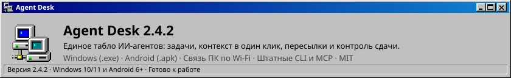
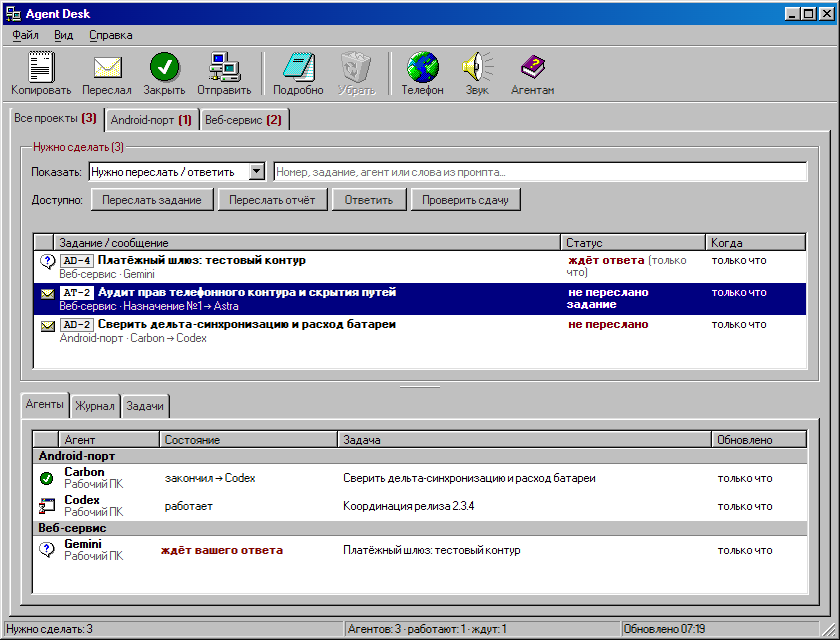
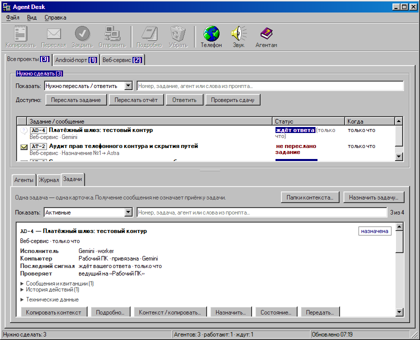
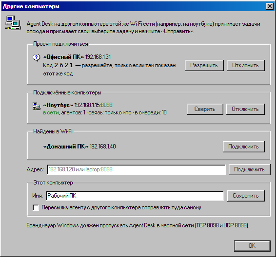

<p align="center"></p>

<p align="center">
  <a href="https://github.com/purrfect0/AgentDesk/releases/latest"></a>
  &nbsp;
  <a href="https://github.com/purrfect0/AgentDesk/releases/latest"></a>
</p>

<p align="center">
  <a href="https://github.com/purrfect0/AgentDesk/actions/workflows/agent-desk.yml"></a>
  <a href="https://github.com/purrfect0/AgentDesk/releases/latest"></a>
  
  
  <a href="LICENSE"></a>
</p>

<p align="center"></p>

**Agent Desk** — рабочее табло в стиле Windows 98 для владельца, который ведёт несколько ИИ-агентов сразу на одном или двух компьютерах. Агенты сообщают о ходе работы через штатные **CLI / MCP** или короткие JSON-маркеры, а приложение показывает одно достоверное состояние каждой задачи, даёт скопировать весь проверенный контекст в один клик и напоминает только о том, где действительно нужно ваше действие. ПК хранит данные, телефон показывает очередь и присылает уведомления по домашнему Wi-Fi, а связанные компьютеры синхронизируют карточки и квитанции между собой.

<p align="center"></p>

<p align="center">
  <br>
  <sub>Главное окно: контекстные действия выбранной карточки, поиск по всем проектам и живые статусы агентов</sub>
</p>

<p align="center">
  <br>
  <sub>Вкладка «Задачи»: одна карточка на весь жизненный цикл работы, история переходов и копирование контекста</sub>
</p>

<p align="center">
  <br>
  <sub>Связь компьютеров по Wi-Fi: подтверждение по коду, очередь синхронизации и ручная сверка в один клик</sub>
</p>

<p align="center"></p>

- **Одно достоверное состояние каждой работы.** Полная цепочка `project_id → task_id → assignment_epoch → message_id`: локальные номера `AD-*` и `AT-*` служат удобными короткими подписями, а одноимённые задачи никогда не склеиваются и не подтверждают друг друга по совпадению заголовка.
- **Контекстные действия и защита промпта.** В строках очереди нет лишних кнопок — действия («Переслать задание», «Переслать отчёт», «Ответить», «Проверить сдачу», «Освободить ресурс») появляются строго по наличию данных. При назначении работают живой счётчик UTF-8 (лимит конверта `58 000 Б`) и сохранение черновика.
- **Компактная дельта-синхронизация (−99% трафика).** Фоновое обновление передаёт только изменившиеся карточки, а полные промпты подгружаются побайтово по запросу — интерфейс остаётся мгновенным даже на тысяче задач.
- **Тихие часы, диагностика и проверка маркеров.** Ночной режим, отключение звуков по отдельным проектам, окно диагностики конвейера с причинами отказов и офлайн-проверка маркера `validate` в CLI и MCP до отправки.
- **Реестр агентов и смена сессии в один клик.** При исчерпании лимита модели (`model_limit`) задача переводится в новую сессию одним нажатием без потери истории и квитанций.
- **Устойчивость к сбоям и обрывам.** Журнал синхронизации умеет безопасно сжиматься и догонять отставший ПК (`snapshot/replay`), а перед каждой записью сохраняется резервная копия `state.json.bak` для автовосстановления после обрыва питания.

Полная история версий и порядок обновления — в [CHANGELOG.md](CHANGELOG.md).

<p align="center"></p>

- **Семь раздельных этапов без ложных галочек:** карточка на доске, требуется переслать, владелец переслал, адресат подтвердил получение (`ACK`), выполняется, сдано на проверку (`submitted`), принято ведущим (`accepted`). Доставка на другой ПК или копирование текста не считаются подтверждением агента, а `ACK` не означает готовность работы.
- **Передача между сессиями и агентами (`handoff / handback`):** при смене исполнителя или компьютера растёт `assignment_epoch` — устаревшая сессия больше не может случайно перезаписать результат новой. Поддерживаются текстовый список проверочных шагов, сверка локальных артефактов по SHA-256 и экспорт пакета передачи в JSON.
- **Чистый учёт активной работы:** явные поручения отделены от исторических наблюдений из старых маркеров, добавлены статусы отмены и архива с фиксацией причины и возможностью переоткрытия координатором.

Подробное описание синхронизации и общей почты — в [инструкции 2.3](docs/linked-mail-2.3.md).

<p align="center"></p>

- **Классический интерфейс Windows 98** с собственным пиксельным кириллическим шрифтом на ПК и телефоне — без размытия и без мигания значков при обновлении.
- **Сквозной поиск по всем проектам:** ищет по короткому номеру `AD/AT`, глобальным `UUID` задачи и сообщения, проекту, агенту, имени компьютера, статусу и словам внутри полного промпта.
- **Всплывающие окна на ПК** складываются аккуратной стопкой в углу экрана, подсказывают конкретное действие и замирают, пока на них наведён курсор.
- **Системный трей Windows:** показывает число карточек, требующих внимания, и задач на проверке, даёт в один клик открыть другие компьютеры, тихие часы или диагностику отказов.
- **Read-only сводка общих ресурсов** (например, тестового телефона или сервера) с источником и свежестью сигнала без выдумывания искусственных блокировок.
- **Безопасный перенос из старого Agent Board:** при первом запуске приложение само подхватывает прежние настройки и открытые карточки.

<p align="center"></p>

1. **Windows (10 / 11 x64):** скачайте `AgentDesk-Setup-*.exe` из [Releases](https://github.com/purrfect0/AgentDesk/releases/latest) и запустите. Права администратора не требуются. При предупреждении SmartScreen нажмите «Подробнее» → «Выполнить в любом случае». В брандмауэре Windows разрешите доступ для **частных сетей**.
2. **Android (6.0+):** скачайте `AgentDesk-*.apk` из [Releases](https://github.com/purrfect0/AgentDesk/releases/latest) на телефон, откройте файл, разрешите установку и показ уведомлений.

<p align="center"></p>

1. На ПК откройте **«Файл → Подключить телефон…»** и при необходимости включите доступ из Wi-Fi — появится QR-код.
2. В приложении на телефоне нажмите **«Сканировать QR-код»** и наведите камеру на экран ПК (либо скопируйте ссылку сопряжения вручную).
3. ПК и телефон должны находиться в одной домашней сети Wi-Fi. Телефон работает в ограниченном контуре: он видит очередь и задачи, но не получает ключи агентов и внутренние пути файловой системы ПК. Если ссылка утекла, нажмите на ПК «Сменить ключ».

<p align="center"></p>

Пока телефон на связи с ПК, фоновая служба держит один лёгкий запрос открытым и показывает уведомление в стиле Windows 98 со звуком приложения в течение секунды — даже с выключенным экраном.

1. В **«Вид → Тихие часы и уведомления…»** на ПК настраиваются ночное расписание и отключение звуков по отдельным фоновым проектам (карточки при этом спокойно сохраняются в очереди без повторного шума).
2. В **«Вид → Уведомления на телефоне…»** на самом телефоне видны статус связи, разрешения и кнопка пробного уведомления через 10 секунд.
3. На оболочках Xiaomi, Honor, Huawei, OPPO, vivo, RedMagic и Nubia включите для Agent Desk **автозапуск**, режим батареи **«Без ограничений»** и закрепите приложение замком в списке недавних.

<p align="center"></p>

1. Установите одинаковую версию Agent Desk на оба компьютера и включите доступ из Wi-Fi (используются TCP `8098` и UDP `8099` в частной сети).
2. Откройте **«Файл → Другие компьютеры…»**, выберите найденный в сети компьютер и нажмите «Подключить», затем сверьте четырёхзначный код на втором экране и нажмите «Разрешить».
3. Связанные компьютеры автоматически синхронизируют поручения, статусы задач и квитанции по защищённому каналу `AES-256-GCM` (при желании отдельно включается обмен файлами проектных папок `mail` до 8 МиБ с проверкой SHA-256 и защитой от конфликтов).

<p align="center"></p>

Вместе с приложением на Windows ставятся готовые обёртки **`agentdesk.cmd`** (CLI) и **`agentdesk-mcp.cmd`** (официальный MCP stdio-сервер на 11 инструментов) — отдельный установленный Node.js для их работы не нужен. Подробная спецификация команд и ключей — в [docs/agent-cli.md](docs/agent-cli.md).

- **Проверить маркер офлайн до отправки:** `agentdesk validate --file marker.json` (или MCP-инструмент `agent_desk_validate`).
- **Прочитать входящие и полный текст задания:** `agentdesk inbox` и `agentdesk read <UUID>`.
- **Подтвердить получение и сдать отчёт:** `agentdesk ack` и `agentdesk submit --file marker.json`.

Если агент работает без CLI/MCP, откройте **«Справка → Инструкция для агентов…»** — приложение соберёт готовый текст инструкции с активными участниками выбранного проекта и лимитами полей. Пример файлового маркера (`.tmp` → `.json`):

```json
{"agent": "Carbon", "session_id": "carbon-20261118-a", "seq": 2,
 "project_id": "4554e900-ca2d-5adc-9b8a-9da371045ae4",
 "task_id": "fc5e11aa-eb62-4f9b-856d-60416bc9a393", "assignment_epoch": 1,
 "state": "done", "execution_state": "submitted", "to": "Codex",
 "task": "Стабилизация дельта-синхронизации", "result": "OUT/REPORT.md",
 "message": "Проверки зелёные, отчёт готов к ревью ведущим.",
 "ack": ["03f04f5f-c155-5cac-8202-6b673012f594"]}
```

<p align="center"></p>

При отправке тега `agent-desk-v*` конвейер GitHub Actions прогоняет тесты ядра и интерфейса, собирает установщик Windows (`.exe`) и пакет Android (`.apk`) с SHA-256 и публикует их в Releases. Подробности о локальной сборке и постоянной подписи APK — в [agent-desk/README.md](agent-desk/README.md).

```bash
cd agent-desk
npm run assets      # 98.css и классические значки Win98
npm ci
npm test            # тесты ядра, синхронизации, безопасности и CLI/MCP
node --test web/linked-ui.test.js
npm run dist:win    # установщик Windows в dist/
```

<p align="center"><sub>MIT · <a href="LICENSE">LICENSE</a> · <a href="CHANGELOG.md">CHANGELOG</a> · <a href="docs/linked-mail-2.3.md">Синхронизация и почта</a> · <a href="docs/agent-cli.md">CLI и MCP</a></sub></p>
