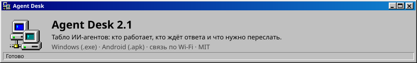
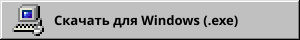
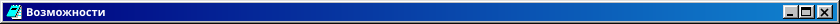
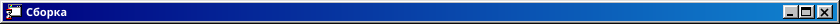

<p align="center"></p>

<p align="center">
  <a href="https://github.com/purrfect0/AgentBoard/releases/latest"></a>
  &nbsp;
  <a href="https://github.com/purrfect0/AgentBoard/releases/latest"></a>
</p>


Agent Desk — табло в стиле Windows 98 для тех, кто работает с несколькими ИИ-агентами одновременно. Агенты пишут короткие JSON-маркеры в папку, а приложение показывает, кто работает, кто застрял и что от вас нужно. ПК хранит данные, телефон показывает то же самое по Wi-Fi.



- **Состояния агентов:** работает, ждёт, заблокирован, готово. Если агент давно молчит, приложение помечает его как недоступного.
- **«Нужно сделать»:** сообщения, которые надо переслать другому агенту (готовый текст и `message_id`), вопросы к вам и упёршиеся в лимит модели. Есть кнопки «Копировать», «Переслал» и «Закрыть».
- **Подтверждение доставки:** агент-получатель отвечает `ack`, и напоминание закрывается само.
- **Акцентные анимации:** мигает то, что требует внимания: недоступные и заблокированные агенты, неотправленные пересылки, счётчики во вкладках.
- **Всплывающие окна** в духе Win98, которые ведут себя как центр уведомлений Windows 11. Новое окно появляется снизу и поднимает старые. Через 20 секунд окно уезжает само, а пока на нём курсор, отсчёт стоит.
- **Вкладки проектов,** значок в трее, автозапуск, звук и громкость.
- **Android-приложение:** подключается к ПК по QR-коду, присылает уведомления, кнопки работают и с телефона.
- **Перенос из Agent Board:** при первом запуске приложение само забирает старые данные из `%USERPROFILE%\AgentBoard`.


1. **Windows:** запустите `AgentDesk-Setup-*.exe`. Права администратора не нужны. SmartScreen покажет предупреждение: «Подробнее» → «Выполнить в любом случае». Брандмауэру разрешите доступ в **частных сетях**.
2. **Android:** откройте `AgentDesk-*.apk`, разрешите установку из неизвестных источников и уведомления. Нужен Android 6 или новее.


1. На ПК откройте «Файл → Подключить телефон…». На экране появится QR-код.
2. В приложении на телефоне нажмите **«Сканировать QR-код»** и наведите камеру на экран. Если сканер недоступен, скопируйте ссылку на ПК и вставьте её в телефоне.
3. ПК и телефон должны быть в одной Wi-Fi сети. Если ссылка утекла, нажмите на ПК «Сменить ключ».


Откройте «Справка → Инструкция для агентов…», скопируйте текст и вставьте его в системные инструкции каждого агента. В тексте описано, какие маркеры писать, как пересылать сообщения и как подтверждать доставку.



После push тега `agent-desk-v*` GitHub Actions соберёт `.exe` и `.apk` и выложит их в Releases. Подробности о локальной сборке и постоянной подписи APK есть в [agent-desk/README.md](agent-desk/README.md).

```
cd agent-desk
npm run assets      # 98.css и иконки Win98
npm install
npm test
npm run dist:win    # dist/AgentDesk-Setup-<версия>.exe
```
