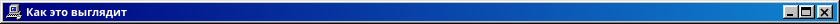
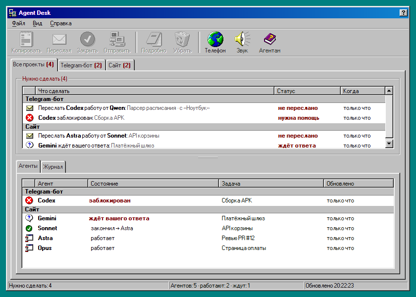
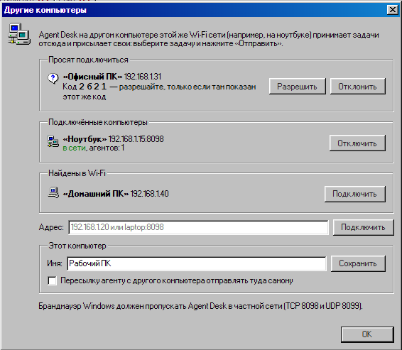
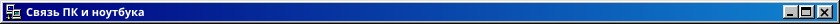

<p align="center"></p>

<p align="center">
  <a href="https://github.com/purrfect0/AgentDesk/releases/latest"></a>
  &nbsp;
  <a href="https://github.com/purrfect0/AgentDesk/releases/latest"></a>
</p>

<p align="center">
  <a href="https://github.com/purrfect0/AgentDesk/actions/workflows/agent-desk.yml"></a>
  <a href="https://github.com/purrfect0/AgentDesk/releases/latest"></a>
  
  
  <a href="LICENSE"></a>
</p>


Agent Desk — табло в стиле Windows 98 для тех, кто работает с несколькими ИИ-агентами одновременно. Агенты пишут короткие JSON-маркеры в папку, а приложение показывает, кто работает, кто застрял и что от вас нужно. ПК хранит данные, телефон показывает то же самое по Wi-Fi, а компьютеры одной сети передают друг другу задачи.



<p align="center"></p>

<p align="center"></p>


- **Связь ПК и ноутбука.** Agent Desk на компьютерах одной Wi-Fi сети находят друг друга. Свяжите их один раз по коду, и задачу можно отправить на другой компьютер кнопкой «Отправить». Пересылка агенту, который работает на другом компьютере, может уходить туда сама.
- **Уведомления с выключенным экраном.** Фоновая служба держит связь с ПК. Уведомление нарисовано в стиле Windows 98, звучит звуком приложения и говорит, что сделать.
- **Телефон во весь экран** и **пиксельный шрифт Windows 98 с кириллицей**: русский текст выглядит так же, как английский.
- **Значки на ПК больше не моргают:** окно обновляет только то, что изменилось.

Все изменения по версиям — в [CHANGELOG.md](CHANGELOG.md).


- **Состояния агентов:** работает, ждёт, заблокирован, готово. Если агент давно молчит, приложение помечает его как недоступного.
- **«Нужно сделать»:** сообщения, которые надо переслать другому агенту (готовый текст и `message_id`), вопросы к вам и упёршиеся в лимит модели. Есть кнопки «Копировать», «Переслал» и «Закрыть».
- **Подтверждение доставки:** агент-получатель отвечает `ack`, и напоминание закрывается само.
- **Акцентные анимации:** мигает то, что требует внимания: недоступные и заблокированные агенты, неотправленные пересылки, счётчики во вкладках.
- **Всплывающие окна** в духе Win98, которые ведут себя как центр уведомлений Windows 11 и говорят, что сделать. Новое окно появляется снизу и поднимает старые. Через 20 секунд окно уезжает само, а пока на нём курсор, отсчёт стоит.
- **Вкладки проектов,** значок в трее, автозапуск, звук и громкость.
- **Android-приложение:** подключается к ПК по QR-коду, работает во весь экран и присылает уведомления в стиле Win98 даже с выключенным экраном. Кнопки работают и с телефона.
- **Несколько компьютеров:** ПК и ноутбук одной Wi-Fi сети отправляют друг другу задачи.
- **Перенос из Agent Board:** при первом запуске приложение само забирает старые данные из `%USERPROFILE%\AgentBoard`.


1. **Windows:** скачайте `AgentDesk-Setup-*.exe` из [Releases](https://github.com/purrfect0/AgentDesk/releases/latest) и запустите. Права администратора не нужны. SmartScreen покажет предупреждение: «Подробнее» → «Выполнить в любом случае». Брандмауэру разрешите доступ в **частных сетях**.
2. **Android:** скачайте `AgentDesk-*.apk` прямо на телефон, откройте его, разрешите установку из неизвестных источников и уведомления. Нужен Android 6 или новее.


1. На ПК откройте «Файл → Подключить телефон…». На экране появится QR-код.
2. В приложении на телефоне нажмите **«Сканировать QR-код»** и наведите камеру на экран. Если сканер недоступен, скопируйте ссылку на ПК и вставьте её в телефоне.
3. ПК и телефон должны быть в одной Wi-Fi сети. Если ссылка утекла, нажмите на ПК «Сменить ключ».


Пока телефон подключён к ПК, фоновая служба ждёт новых событий, и уведомление приходит даже с выключенным экраном. В шторке при этом остаётся тихий значок «На связи с ПК».

1. Откройте в приложении «Вид → Уведомления на телефоне…». Там видно, работает ли связь, разрешены ли уведомления и не мешает ли экономия батареи.
2. Nubia, RedMagic, Xiaomi и другие оболочки усыпляют фоновые приложения сильнее обычного Android. Нажмите «О приложении…» и включите **автозапуск**, в «Батарея…» выберите **«Без ограничений»**, а в списке недавних приложений закрепите Agent Desk замком.
3. Кнопка «Проверить» пришлёт пробное уведомление через 10 секунд: выключите экран и дождитесь его.



1. Поставьте Agent Desk на оба компьютера и на каждом включите доступ из Wi-Fi: «Файл → Подключить телефон…» → «Включить доступ из Wi-Fi». Брандмауэру разрешите доступ в частных сетях, Agent Desk использует TCP 8098 и UDP 8099.
2. На одном компьютере откройте «Файл → Другие компьютеры…». Второй появится в списке «Найдены в Wi-Fi», нажмите «Подключить». Если его там нет, введите адрес, например `192.168.1.20`.
3. На втором компьютере всплывёт окно с запросом. Если код в нём совпадает с кодом на первом компьютере, нажмите «Разрешить».
4. Выберите задачу в «Нужно сделать» и нажмите **«Отправить»**. На другом компьютере задача появится с пометкой, откуда пришла, а здесь закроется с пометкой, куда ушла.

Связь запоминается на обоих компьютерах. Галочка в том же окне включает автоотправку: пересылка агенту, который работает на подключённом компьютере, уходит туда сама.


Откройте «Справка → Инструкция для агентов…», скопируйте текст и вставьте его в системные инструкции каждого агента. В тексте описано, какие маркеры писать, как пересылать сообщения и как подтверждать доставку. Маркер выглядит так:

```json
{"agent": "Codex", "state": "waiting", "waiting_for": "owner_forward", "to": "Astra",
 "task": "review PR", "message": "Проверь PR #12", "ack": ["AD-7"]}
```


После push тега `agent-desk-v*` GitHub Actions соберёт `.exe` и `.apk` и выложит их в Releases. Подробности о локальной сборке и постоянной подписи APK есть в [agent-desk/README.md](agent-desk/README.md).

```
cd agent-desk
npm run assets      # 98.css и иконки Win98
npm install
npm test
npm run dist:win    # dist/AgentDesk-Setup-<версия>.exe
```

<p align="center"><sub>MIT · <a href="LICENSE">LICENSE</a> · <a href="CHANGELOG.md">CHANGELOG</a></sub></p>
